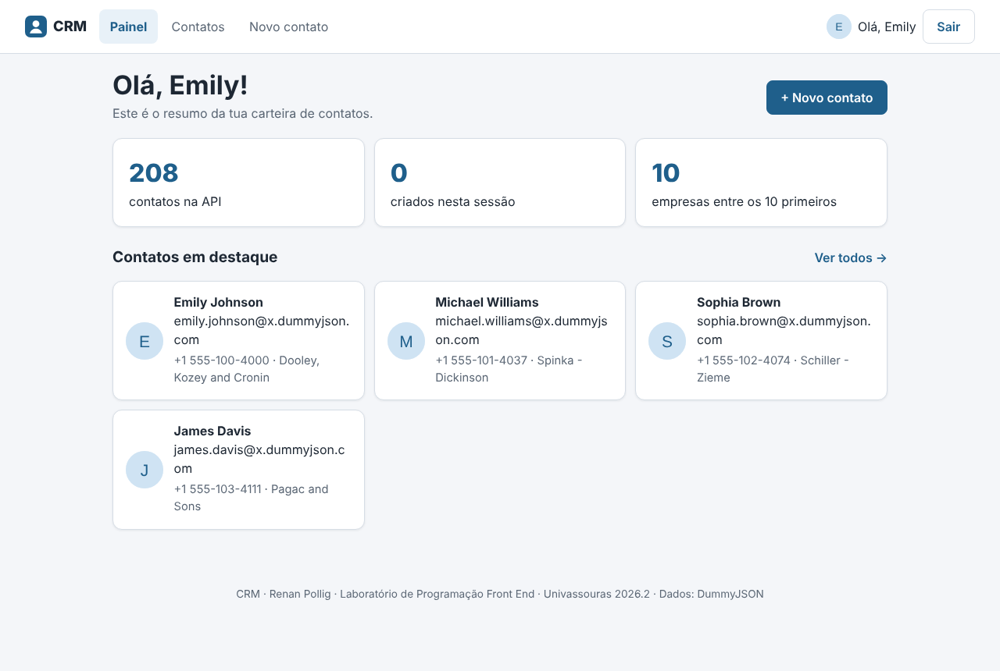
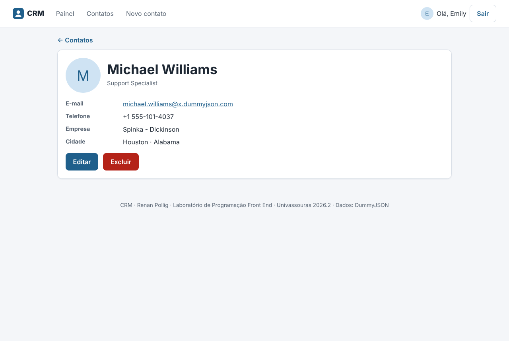
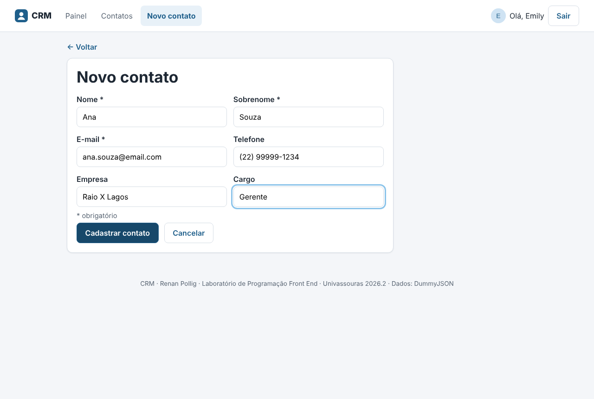

# CRM · Renan Pollig

Sistema de gestão de contatos (CRM) feito em React + TypeScript para a disciplina
Laboratório de Programação Front End (Univassouras, 2026.2) · Profa. Laís Cristine Bordallo Pinheiro.

## O que faz

- Login com token (DummyJSON), sessão restaurada no F5 e rotas protegidas
- Sair apaga o token; token vencido (401) volta ao Login automaticamente
- Painel com resumo e contatos em destaque
- Lista de contatos com busca (`/users/search`), paginação e estados de carregando, vazio e erro
- Detalhe do contato com editar e excluir (com confirmação)
- Formulário de criar e editar com validação
- Mensagens de erro claras por status (400, 401, 404, 5xx e sem conexão) com botão "Tentar de novo"
- Layout responsivo (mobile-first), testado em 360 e 375 px

## Telas

| Rota | Tela | Acesso |
|---|---|---|
| `/login` | Login | pública |
| `/` | Painel | protegida |
| `/contatos` | Lista com busca | protegida |
| `/contatos/:id` | Detalhe (editar e excluir) | protegida |
| `/contatos/novo` e `/contatos/:id/editar` | Formulário criar/editar | protegida |
| menu | Navegação + Sair | protegida |
| `*` | Página 404 | qualquer um |

## Como rodar

1. `git clone https://github.com/RPollig/CRM-P2-FrontEnd-Renan-Pollig.git`
2. `cd CRM-P2-FrontEnd-Renan-Pollig`
3. Crie o arquivo `.env` (veja abaixo)
4. `npm install`
5. `npm run dev` (abre em http://localhost:5173)
6. Para testar o build: `npm run build` e `npm run preview`

## Variáveis de ambiente

Crie `.env` na raiz, igual ao `.env.example`:

```
VITE_API_URL=https://dummyjson.com
```

## Login de teste

usuário `emilys` · senha `emilyspass` (conta de teste pública do DummyJSON)

## Tecnologias

React · TypeScript · Vite · React Router · Axios · CSS

## Organização do código

```
src/
  services/   http.ts (Axios + interceptors) · auth.ts · contatos.ts (CRUD)
  contexts/   AuthContext (login/token) · ContatosLocaisContext (mudanças feitas no app)
  routes/     ProtectedRoute (só entra logado)
  pages/      Login · Painel · Contatos · ContatoDetalhe · ContatoForm · NaoEncontrada
  components/ Header · Layout · ContatoCard
  utils/      erros.ts (mensagem por status)
  types.ts
```

## Observação

O DummyJSON só simula criar/editar/excluir: a API responde, mas não grava.
A tela atualiza o estado local (`ContatosLocaisContext`), então a lista mostra
o que foi criado, editado ou excluído enquanto o app está aberto. No F5 essas
mudanças somem, porque o servidor de treino não as guardou.

## Prints

| Login | Painel | Lista |
|---|---|---|
|  |  |  |

| Detalhe | Formulário | Celular (375 px) |
|---|---|---|
|  |  |  |
