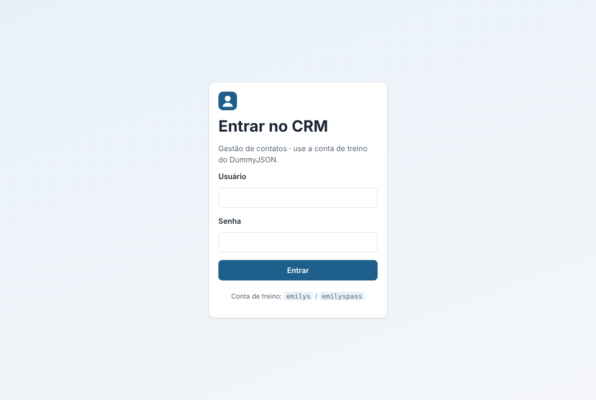
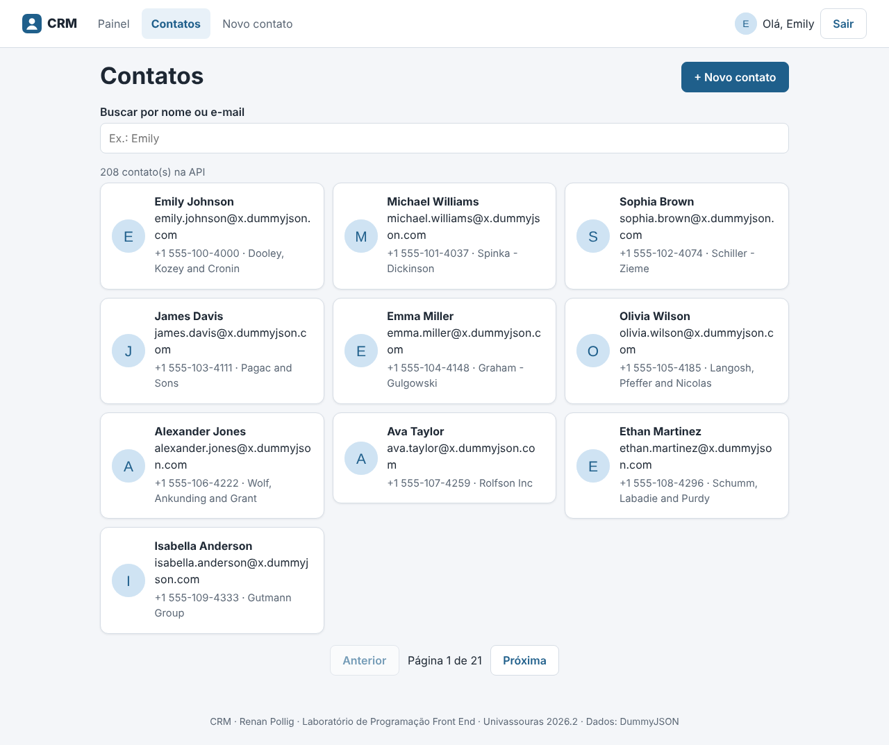
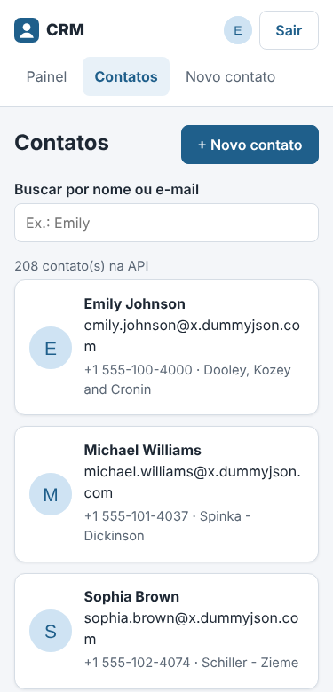

# CRM - Trabalho P2 Front-End

Sistema de gestão de contatos (CRM) desenvolvido para o Trabalho P2 da disciplina de Laboratório de Programação Front-End do curso de Engenharia de Software.

## Aluno

Renan Pollig Ferreira

## Sobre o projeto

O CRM permite entrar com login (token), ver um painel, listar e buscar contatos, ver o detalhe de cada contato, cadastrar, editar e excluir (com confirmação). Os dados vêm da API de treino DummyJSON (recurso `/users`).

## O que faz

- Login com token (DummyJSON), sessão mantida no F5 e rotas protegidas
- Sair apaga o token; token vencido (401) volta ao Login
- Painel com resumo e contatos em destaque
- Lista de contatos com busca (`/users/search`), paginação e estados de carregando, vazio e erro
- Detalhe do contato com editar e excluir (com confirmação)
- Formulário de criar e editar com validação
- Mensagens de erro por status (400, 401, 404, 5xx e sem conexão) com botão "Tentar de novo"
- Layout responsivo (mobile-first), testado em 360 e 375 px

## Telas

| Rota | Tela | Acesso |
|---|---|---|
| `/login` | Login | pública |
| `/` | Painel | protegida |
| `/contatos` | Lista com busca | protegida |
| `/contatos/:id` | Detalhe (editar e excluir) | protegida |
| `/contatos/novo` e `/contatos/:id/editar` | Formulário criar/editar | protegida |
| menu | Navegação + Sair | protegida |
| `*` | Página 404 | qualquer um |

## Tecnologias utilizadas

- React
- TypeScript
- Vite
- React Router
- Axios
- CSS
- Git e GitHub

## Como executar

1. Clone o repositório da disciplina: `git clone https://github.com/RPollig/Univassouras-EngenhariaSoftware-FrontEnd.git`
2. Entre na pasta do trabalho: `cd Univassouras-EngenhariaSoftware-FrontEnd/trabalho-p2-crm`
3. Crie o arquivo `.env` (veja abaixo)
4. Execute `npm install`
5. Execute `npm run dev` e abra `http://localhost:5173`
6. Para testar o build: `npm run build` e `npm run preview`

## Variáveis de ambiente

Crie `.env` na pasta `trabalho-p2-crm`, igual ao `.env.example`:

```
VITE_API_URL=https://dummyjson.com
```

## Login de teste

usuário `emilys` · senha `emilyspass` (conta de teste pública do DummyJSON)

## Organização do código

```
src/
  services/   http.ts (Axios + interceptors) · auth.ts · contatos.ts (CRUD)
  contexts/   AuthContext (login/token) · ContatosLocaisContext (mudanças feitas no app)
  hooks/      useContato (carrega um contato: carregando / erro / 404)
  routes/     ProtectedRoute (só entra logado)
  pages/      Login · Painel · Contatos · ContatoDetalhe · ContatoForm · NaoEncontrada
  components/ Header · Layout · ContatoCard · FormularioContato · Estados
  utils/      erros.ts (mensagem por status)
  types.ts
```

## Observação

O DummyJSON só simula criar, editar e excluir: a API responde, mas não grava.
A tela atualiza o estado local (`ContatosLocaisContext`), então a lista mostra
o que foi criado, editado ou excluído enquanto o app está aberto. No F5 essas
mudanças somem, porque o servidor de treino não as guardou.

## Prints

| Login | Painel | Lista |
|---|---|---|
|  |  |  |

| Detalhe | Formulário | Celular (375 px) |
|---|---|---|
|  |  |  |

## Disciplina

Laboratório de Programação Front-End
Profª Laís Cristine Bordallo Pinheiro
Engenharia de Software - 2026
